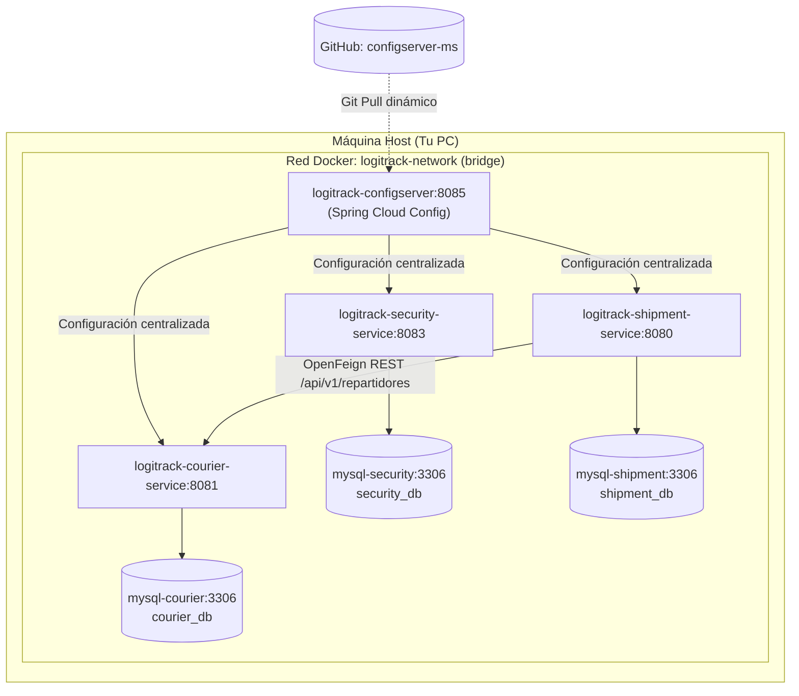

# 📦 LogiTrack Infraestructura & Orquestación (Sprint 2)

[](https://www.docker.com/)
[](https://docs.docker.com/compose/)
[](https://adoptium.net/)
[](https://spring.io/projects/spring-boot)
[](https://www.mysql.com/)

Repositorio oficial de infraestructura y orquestación del proyecto **LogiTrack (LazyHawk)** para la cátedra de **DAAS (2026)** - Universidad Nacional de Jujuy (UNJu).

Este repositorio centraliza el archivo `docker-compose.yml` para desplegar el ecosistema completo de microservicios, bases de datos aisladas y el servidor de configuración en cualquier entorno con un solo comando.

---

## 🏛️ Arquitectura del Ecosistema

El despliegue implementa el patrón **Database-per-Service** con aislamiento total de persistencia y comunicación inter-servicio síncrona a través de una red virtual interna:



---

## 📋 Requisitos Previos

1. **[Docker Desktop](https://www.docker.com/products/docker-desktop/)** instalado y en ejecución (en Windows, habilitar la integración con WSL 2).
2. **Git** instalado.
3. **Puertos libres en el Host:**
   * Microservicios: **`8085`** (Config Server), **`8080`** (Shipments), **`8081`** (Couriers), **`8083`** (Security).
   * Bases de Datos: **`3309`** (`shipment_db`), **`3308`** (`courier_db`), **`3307`** (`security_db`).

> [!NOTE]
> Los puertos de MySQL en el host se asignaron al `3307`, `3308` y `3309` para evitar cualquier colisión con un servicio de MySQL local que ya tengas corriendo en tu Windows en el puerto `3306`.

---

## 🚀 Despliegue Rápido (1 solo comando)

Las imágenes oficiales del proyecto ya se encuentran precompiladas y publicadas en **Docker Hub** (`luism46/...`). No necesitas instalar Java 25 ni Maven en tu máquina.

1. **Clonar este repositorio de infraestructura:**
   ```bash
   git clone https://github.com/logitrack-lazyhawk/logitrack-infra.git
   cd logitrack-infra
   ```

2. **Levantar el ecosistema completo:**
   ```bash
   docker compose up -d
   ```

Docker descargará automáticamente las imágenes oficiales e iniciará los **7 contenedores sincronizados** en su orden correcto de dependencias.

---

## ✅ Verificación del Despliegue

### 1. Estado de los contenedores
Ejecuta:
```bash
docker compose ps
```
Deberías ver los 7 contenedores en estado `Up` y `healthy`:
* `logitrack-configserver`
* `logitrack-courier-service`
* `logitrack-security-service`
* `logitrack-shipment-service`
* `logitrack-mysql-shipment`
* `logitrack-mysql-courier`
* `logitrack-mysql-security`

### 2. Endpoints de Salud (Actuator Health)

| Microservicio | Puerto Host | Endpoint de Salud | Estado Esperado |
| :--- | :---: | :--- | :---: |
| **Config Server** | `8085` | [http://localhost:8085/actuator/health](http://localhost:8085/actuator/health) | `{"status":"UP"}` |
| **Courier Service** | `8081` | [http://localhost:8081/actuator/health](http://localhost:8081/actuator/health) | `{"status":"UP"}` |
| **Shipment Service** | `8080` | [http://localhost:8080/actuator/health](http://localhost:8080/actuator/health) | `{"status":"UP"}` |
| **Security Service** | `8083` | [http://localhost:8083/actuator/health](http://localhost:8083/actuator/health) | `403 Forbidden` *(Protegido por Spring Security)* |

### 3. Documentación Interactiva (Swagger UI)
* **Shipment Service:** [http://localhost:8080/swagger-ui.html](http://localhost:8080/swagger-ui.html)
* **Courier Service:** [http://localhost:8081/swagger-ui.html](http://localhost:8081/swagger-ui.html)

---

## 🧪 Pruebas de Integración (OpenFeign)

El sistema precarga automáticamente datos de prueba desde scripts `data.sql` mediante Hibernate:
* **Repartidor Activo:** `d1111111-1111-1111-1111-111111111111` (*Carlos Gómez*)
* **Repartidor Inactivo:** `d5555555-5555-5555-5555-555555555555` (*Roberto Díaz*)
* **Envío Pendiente:** `aaaaaaa1-aaaa-aaaa-aaaa-aaaaaaaaaaaa`

### Test 1: Asignar Repartidor Activo (Comunicación Feign Exitosa)
En PowerShell o cURL:
```bash
curl -X POST http://localhost:8080/api/v1/envios/aaaaaaa1-aaaa-aaaa-aaaa-aaaaaaaaaaaa/asignar-repartidor `
  -H "Content-Type: application/json" `
  -d '{"repartidorId": "d1111111-1111-1111-1111-111111111111"}'
```
*Respuesta esperada:* `200 OK` con el JSON del envío y el campo `repartidorId` asignado.

### Test 2: Validar Regla de Negocio (Rechazo por Inactivo)
```bash
curl -X POST http://localhost:8080/api/v1/envios/aaaaaaa1-aaaa-aaaa-aaaa-aaaaaaaaaaaa/asignar-repartidor `
  -H "Content-Type: application/json" `
  -d '{"repartidorId": "d5555555-5555-5555-5555-555555555555"}'
```
*Respuesta esperada:* `400 Bad Request` con mensaje *"Operación no permitida: El repartidor se encuentra inactivo y no está disponible."*

---

## 🗄️ Conexión a las Bases de Datos (DBeaver / Workbench)

Puedes inspeccionar directamente las tablas conectándote a `localhost`:

| Base de Datos | Puerto Host | Base / Schema | Usuario | Password |
| :--- | :---: | :---: | :---: | :---: |
| **Envíos** | `3309` | `shipment_db` | `root` | `root` |
| **Repartidores** | `3308` | `courier_db` | `root` | `root` |
| **Seguridad** | `3307` | `security_db` | `root` | `root` |

---

## 🛠️ Comandos de Operación Frecuentes

```bash
# Ver estado de los contenedores
docker compose ps

# Ver logs de un microservicio en tiempo real
docker compose logs -f shipment-service
docker compose logs -f courier-service
docker compose logs -f configserver

# Reiniciar un servicio
docker compose restart shipment-service

# Detener los contenedores (conservando los datos de las bases)
docker compose stop

# Reanudar los contenedores
docker compose start

# Apagar y eliminar los contenedores y la red
docker compose down

# Apagar y BORRAR los volúmenes (para reiniciar las bases de datos de cero)
docker compose down -v
```

---

## 👥 Repositorios de la Organización

* [logitrack-infra](https://github.com/logitrack-lazyhawk/logitrack-infra) (Orquestación con Docker Compose)
* [configserver-ms](https://github.com/logitrack-lazyhawk/configserver-ms) (Repositorio Git de propiedades centralizadas)
* [config-server](https://github.com/logitrack-lazyhawk/config-server) (Microservicio Spring Cloud Config Server)
* [shipment-service](https://github.com/logitrack-lazyhawk/shipment-service) (Microservicio de Envíos y Tarifas)
* [courier-service](https://github.com/logitrack-lazyhawk/courier-service) (Microservicio de Repartidores)
* [security-service](https://github.com/logitrack-lazyhawk/security-service) (Microservicio de Autenticación y JWT)
